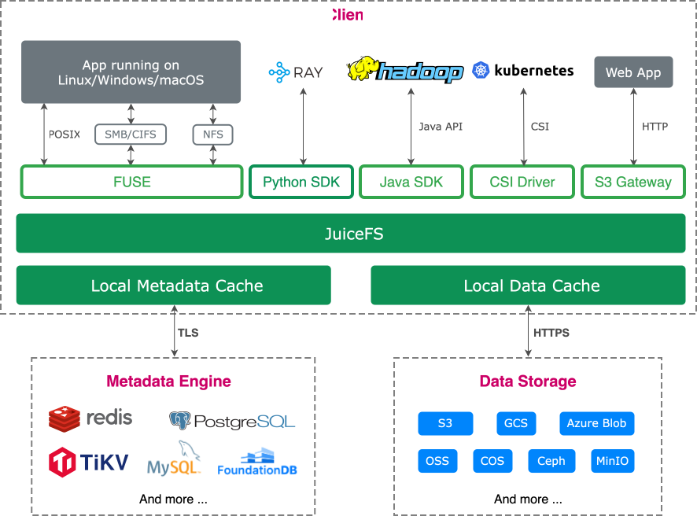
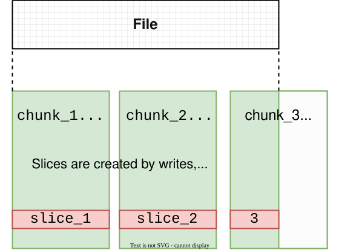

# JuiceFS vs. BeeGFS {#juicefs-vs-beegfs}

[BeeGFS](https://www.beegfs.io) is a parallel distributed file system originally developed at Germany's Fraunhofer research institute and now maintained by ThinkParQ. It stripes files across multiple storage servers to provide a shared namespace and parallel I/O. BeeGFS is used in supercomputing centers, research institutions, and HPC and AI clusters.

JuiceFS is a cloud-native distributed file system that stores data in object storage. The Community Edition integrates with multiple metadata services and supports a broad range of workloads. It was open-sourced on GitHub in 2021. The Enterprise Edition is designed for high-performance workloads and is used in large-scale AI applications, including generative AI, autonomous driving, quantitative finance, and biotechnology.

This article compares BeeGFS and JuiceFS in terms of architecture, file distribution, features, and licensing. The BeeGFS discussion is based on its version 8.4 documentation.

## Architecture comparison {#architecture-comparison}

### BeeGFS {#beegfs}

BeeGFS consists of the following components. Its server components run as regular user-space processes and can be deployed on separate servers or colocated on the same server:

- **Management Service**: Acts as the cluster registry and watchdog, tracking clients, servers, storage targets, and mirror buddy groups. It does not participate in file I/O. The management service was rewritten in Rust for version 8.0.
- **Metadata Service**: Manages directory structures, file attributes, and stripe layouts. Multiple metadata services can each manage part of the namespace.
- **Storage Service**: Stores striped file data on storage targets: local ext4, XFS, or ZFS file systems on the servers, often backed by RAID volumes.
- **Client**: Provides a standard mount point through a Linux kernel module, allowing applications to access the file system without modification.
- **Monitoring Service**: An optional component that collects server metrics into a time-series database such as InfluxDB for visualization with tools such as Grafana.

Clients and servers communicate over TCP/IP or RDMA networks such as InfiniBand, Omni-Path, and RoCE. After obtaining a file's stripe layout from the metadata service, clients read and write directly to multiple storage services in parallel.

### JuiceFS {#juicefs}

JuiceFS uses a modular architecture with three core components:

- **Metadata engine**: Stores standard file system metadata and file data indexes. The Community Edition supports databases such as Redis, TiKV, MySQL, PostgreSQL, and FoundationDB. The Enterprise Edition uses a proprietary high-performance metadata service.
- **Data storage**: Typically a public cloud or self-hosted object storage service. JuiceFS supports more than 30 storage backends, including AWS S3, Azure Blob, Google Cloud Storage, MinIO, and Ceph RADOS.
- **Client**: Provides access through POSIX mounts using FUSE, the Hadoop Java SDK, the CSI Driver, the S3 Gateway, and the Python SDK.

### Architectural differences {#architectural-differences}

#### Storage module {#storage-module}

BeeGFS manages its own data storage. Storage targets use local file systems on the servers, and data protection depends on the underlying RAID configuration and optional [Buddy Mirroring](https://doc.beegfs.io/8.4/advanced_topics/mirroring.html). Buddy Mirroring pairs two storage targets: writes go to the primary target, which synchronously forwards them to the secondary before acknowledging completion. The secondary takes over if the primary fails. Mirroring is disabled by default, requires an enterprise license, and does not replace backups. Adding storage targets does not automatically redistribute existing data; this requires data migration tools or the enterprise background rebalancing feature.

JuiceFS stores file data in object storage, which provides data placement and redundancy. With managed object storage, users do not manage disks or RAID at the JuiceFS layer. With self-hosted object storage, they still maintain the underlying storage cluster. The Community Edition provides local client caching. The Enterprise Edition adds distributed caching to share frequently accessed data and scale cache capacity and read performance independently.

#### Metadata module {#metadata-module}

BeeGFS distributes metadata by directory. A directory's contents are managed by a single metadata service, selected randomly when the directory is created. One metadata service hosts the root directory. Adding metadata services distributes the load of additional directories, but a single hot directory remains the responsibility of one service. Metadata can also use Buddy Mirroring, which requires paired metadata services. Failover depends on the management service being available.

JuiceFS Community Edition provides metadata interfaces for key-value databases such as Redis and TiKV, and relational databases such as MySQL and PostgreSQL. Metadata performance and reliability depend on the selected database. The Enterprise Edition uses a proprietary metadata service, with each metadata zone replicated by a three-node Raft group for high availability. On-premises deployments support horizontal scaling by adding zones and balancing load through metadata migration. See the [Enterprise Edition architecture](https://juicefs.com/docs/cloud/introduction/architecture).

#### Client {#client}

The BeeGFS client runs in kernel space and can use RDMA to optimize network transfers. Deployment and upgrades require compatibility between the client module and the Linux kernel. Major-version upgrades also require planning for changes to network protocols and on-disk formats. Actual I/O performance depends on storage devices, the network, and access patterns.

The JuiceFS client is written in Go and runs in user space through FUSE, without a JuiceFS-specific kernel module. In addition to FUSE mounts, JuiceFS provides the Java SDK, Python SDK, S3 Gateway, and CSI Driver so that big data applications, AI frameworks, and Kubernetes workloads can access the same file system.

#### Caching and consistency {#cache-and-consistency}

BeeGFS clients provide two [caching modes](https://doc.beegfs.io/8.4/advanced_topics/client_caching.html). The default `buffered` mode uses small static buffers, typically a few hundred kilobytes per file, for read-ahead and write-back. The `native` mode uses the Linux page cache and can cache multiple gigabytes. These modes do not provide a persistent client disk cache; performance also depends on server caching and network capacity.

JuiceFS Community Edition caches data in client memory and on local disks, with a default disk cache limit of 100 GiB. It supports read-ahead, prefetching, and cache warmup. The Enterprise Edition adds distributed caching, allowing compute nodes to share cached data or use a dedicated cache cluster. For repeated reads, such as model loading and multi-epoch training, caching reduces object storage access. Both editions provide close-to-open consistency: after one client modifies and closes a file, other clients see the latest contents when they reopen it. See [Cache](../../guide/cache.md#consistency).

## File distribution comparison {#file-distribution-comparison}

### BeeGFS file distribution {#beegfs-file-distribution}

BeeGFS stripes files across storage targets using fixed-size chunks. The number of targets and the chunk size are configurable. Stripe patterns can be set on directories and are inherited by new files and subdirectories. Changing a directory's stripe pattern does not change existing files. There are two stripe patterns:

- **raid0**: Standard striping, with one copy of each chunk.
- **mirrored**: Each chunk is written to both storage targets in a buddy group.

When selecting targets for new files, BeeGFS classifies targets into Normal, Low, and Emergency capacity pools based on free space, preferring Normal targets. Enterprise storage pools can group targets by media or performance characteristics into named pools, such as `fast` and `bulk`.

BeeGFS 8 provides [Remote Storage Targets](https://doc.beegfs.io/8.4/advanced_topics/remote_storage_targets.html), an enterprise feature that uses additional Remote and Sync services to explicitly push files to S3-compatible object storage or pull them back into BeeGFS. This supports data import, export, and archival. Object storage serves as a synchronization destination or source rather than the primary data backend for ordinary BeeGFS file I/O.

### JuiceFS file distribution {#juicefs-file-distribution}

JuiceFS organizes file data using chunks, slices, and blocks. Files are divided at fixed 64 MiB chunk boundaries for lookup and positioning. Each slice represents a contiguous write within a chunk. Blocks, with a default maximum size of 4 MiB, are the physical storage units used in object storage and disk caches.

Slices are written once. File modifications create new slices and update metadata instead of modifying existing objects in place. This reduces dependence on the consistency behavior of object storage and simplifies caching. Frequent small writes can create many slices, which JuiceFS compacts through background tasks.

## Feature comparison {#feature-comparison}

| Feature | BeeGFS | JuiceFS Community Edition | JuiceFS Enterprise Edition |
| --- | --- | --- | --- |
| Metadata | Built-in service, distributed by directory | Independent database service | Proprietary distributed metadata engine with horizontal scaling |
| Metadata redundancy | Buddy Mirroring (enterprise feature) | Depends on the database | Three replicas using Raft |
| Data storage | Self-managed local server file systems | Object storage | Object storage |
| Data redundancy | Underlying RAID and Buddy Mirroring (enterprise feature) | Provided by object storage | Provided by object storage |
| Data caching | Client memory cache | Local cache | Distributed cache, dedicated cache clusters, and optional cache backups |
| Data encryption | TLS for management traffic; encryption at rest depends on underlying storage | Supported | Supported |
| Data compression | Provided by underlying file systems such as ZFS | Supported | Supported |
| Quota management | User and group quotas (enterprise feature) | Supported | Supported |
| Network protocol | TCP/RDMA | TCP | TCP/RDMA |
| Consistency | Depends on client caching and application synchronization | close-to-open | close-to-open |
| Snapshots and clones | Underlying snapshots require coordination across metadata and data targets | Cloning supported | Cloning supported |
| POSIX ACL | Supported | Supported | Supported |
| POSIX compliance | Compatible | Fully compatible | Fully compatible |
| CSI Driver | Supported, maintained by ThinkParQ | Supported | Supported |
| Client access | Kernel client | POSIX (FUSE), Java SDK, Python SDK, S3 Gateway | POSIX (FUSE), Java SDK, Python SDK, S3 Gateway |
| Multi-cloud mirroring | Not supported | Not supported | Supported |
| Cross-cloud and cross-region replication | Not supported | Not supported | Supported |
| Primary maintainer | ThinkParQ | Juicedata | Juicedata |
| Development language | C/C++, Rust (management service) | Go | Go |
| License | GPLv2 for the client; BeeGFS EULA for server components | Apache License 2.0 | Commercial software |

The following qualifications apply:

- **Data encryption**: JuiceFS encryption at rest protects data blocks uploaded to object storage. It does not cover file metadata or local client caches. See [Data Encryption](../../security/encryption.md).
- **Cloning**: JuiceFS clones reference existing object data blocks and are not atomic, file-system-wide snapshots. In the Community Edition, file cloning is atomic, but directory cloning is not. See [Clone Files or Directories](../../guide/clone.md) and the [Enterprise Edition cloning documentation](https://juicefs.com/docs/cloud/guide/clone).
- **POSIX ACL**: The Community Edition supports POSIX ACLs starting from version 1.2. ACLs must be enabled for the volume and cannot subsequently be disabled. See [POSIX ACL](../../security/posix_acl.md). The Enterprise Edition has a separate configuration mechanism; see [Client Access Control](https://juicefs.com/docs/cloud/acl). BeeGFS requires ACL support to be enabled on both metadata services and clients.
- **RDMA and caching**: Starting from version 5.3, JuiceFS Enterprise Edition provides [RDMA acceleration](https://juicefs.com/docs/cloud/guide/distributed-cache-rdma) for the distributed cache data path. Metadata and object storage use their respective communication paths. Cache backups improve cache availability but do not replace object storage redundancy or strictly guarantee two copies of every cached block. See [Distributed Cache](https://juicefs.com/docs/cloud/guide/distributed-cache).
- **Cross-region replication and mirroring**: The table distinguishes integrated replication from explicit data movement. BeeGFS RST moves data between BeeGFS and remote object storage. The Community Edition can move data with `juicefs sync`. Enterprise Edition [data replication](https://juicefs.com/docs/cloud/guide/replication) and [mirror file systems](https://juicefs.com/docs/cloud/guide/mirror) cover object data and metadata respectively and involve asynchronous replication delays.

## Licensing and cost {#licensing-and-cost}

The BeeGFS client is licensed under GPLv2, while server components use ThinkParQ's BeeGFS EULA. BeeGFS is available in community and enterprise editions. According to the [BeeGFS website](https://www.beegfs.io/c/enterprise-features) and [version 8.4 licensing documentation](https://doc.beegfs.io/8.4/advanced_topics/licensing.html):

- Community capacity is limited to 1,200 TB: 1,000 TB of HDD storage plus 200 TB of SSD storage. High availability, Buddy Mirroring, quota enforcement, storage pools, Remote Storage Targets, and background data rebalancing are enterprise features.
- Starting from version 8.4, installations without a license allow at most five client mounts. BeeOND also requires a valid license to start.
- Enterprise licensing counts machines running metadata or storage services; clients are not included in that machine count.

JuiceFS Community Edition uses Apache License 2.0. Compression, encryption, quotas, and POSIX ACLs are included in the open-source edition. The Enterprise Edition is commercial software with a distributed metadata engine, distributed caching, multi-cloud mirroring, and other enterprise capabilities.

BeeGFS costs include storage servers, disks, networking, and the capacity overhead of RAID and Buddy Mirroring. JuiceFS costs include metadata services, object storage capacity and requests, network traffic, and cache devices. The Enterprise Edition also involves commercial licensing and dedicated cache cluster costs where applicable. Managed object storage commonly offers usage-based billing, while self-hosted storage still requires hardware capacity planning. Total costs should be compared at equivalent capacity, availability, and retention targets.

## AI workloads {#ai-workloads}

For training reads, BeeGFS aggregates bandwidth through file striping and parallel storage targets. JuiceFS Community Edition uses local caches for repeated reads, while Enterprise Edition shared caches and dedicated cache clusters allow data reuse across compute nodes. Tests should cover both cold and warmed-up reads, measuring samples per second, GPU data wait time, and contention between jobs rather than sequential bandwidth alone.

For inference model distribution, measure how long multiple new nodes take to load a model and become ready to serve. The Community Edition generally needs to build caches on new nodes. The Enterprise Edition can reuse a dedicated cache cluster. With BeeGFS, evaluate storage target hot spots and network contention when nodes load the same model concurrently.

For checkpoints, completion should mean the data can be durably recovered. Distinguish client buffering, remote receipt, and persistence to the underlying storage. With asynchronous JuiceFS write caching, local staging or cache group receipt is not equivalent to object upload completion. With BeeGFS Buddy Mirroring, durability should also be verified against the underlying storage configuration.

## Summary {#summary}

BeeGFS is a parallel file system for HPC workloads with a performance-oriented design:

- **Local storage and striping**: Files are striped across local disks on multiple storage servers to aggregate bandwidth.
- **Kernel client and RDMA**: The kernel client supports RDMA networks such as InfiniBand and RoCE to optimize transfers.
- **Directory-based metadata distribution**: Multiple metadata services share responsibility for the namespace.
- **BeeOND**: Local disks on compute nodes can form an on-demand temporary file system for an individual job.

This design can deliver high aggregate bandwidth with suitable hardware. Users manage the servers, disks, and network, maintain client compatibility with the kernel, and obtain enterprise licenses for features such as high availability, quotas, and storage pools.

JuiceFS separates file data from metadata, using object storage as the data layer so that capacity, compute, and caching can be planned separately. It offers multiple application interfaces:

- **Enterprise capabilities**: Distributed caching, distributed metadata services, mirror file systems, and cross-region data replication.
- **Network optimization**: Distributed cache transport optimizations, including RDMA acceleration starting from Enterprise Edition 5.3.
- **Cloud-native integration**: POSIX-compatible access, an active open-source ecosystem, and Kubernetes CSI support.
- **Open Community Edition**: Apache License 2.0, with quotas, encryption, compression, and POSIX ACLs available without additional feature licensing.
