# JuiceFS 对比 BeeGFS {#juicefs-vs-beegfs}

[BeeGFS](https://www.beegfs.io) 是一款并行分布式文件系统，最初由德国 Fraunhofer 研究所开发，目前由 ThinkParQ 公司维护。BeeGFS 将文件条带化分布到多台存储服务器上，提供统一的命名空间和并行 I/O 能力，广泛应用于超算中心、科研机构以及 HPC 和 AI 计算集群。

JuiceFS 是一个云原生分布式文件系统，其数据存储在对象存储中。社区版可与多种元数据服务集成，适用场景广泛，于 2021 年在 GitHub 开源。企业版专为高性能场景设计，广泛应用于大规模 AI 任务，涵盖生成式 AI、自动驾驶、量化金融和生物科技等。

本文从架构设计、文件分布、功能特性和许可协议等方面对 BeeGFS 和 JuiceFS 进行对比。BeeGFS 部分以 8.4 版本的官方文档为依据。

## 架构对比 {#architecture-comparison}

### BeeGFS {#beegfs}

BeeGFS 由以下服务组成。各服务端组件均为普通的用户态进程，既可以部署在独立的服务器上，也可以合并部署在同一台服务器上：

- **管理服务（Management Service）**：集群的注册中心和看门狗，记录客户端、服务端节点、存储目标和镜像组等信息，不参与文件 I/O。自 8.0 版本起，管理服务使用 Rust 重写。
- **元数据服务（Metadata Service）**：管理目录结构、文件属性和条带信息。可以部署多个元数据服务，每个服务负责命名空间的一部分。
- **存储服务（Storage Service）**：存储条带化后的文件数据。数据保存在存储目标（Storage Target）上，即服务器本地的 ext4、XFS 或 ZFS 文件系统，通常构建在 RAID 卷之上。
- **客户端（Client）**：以 Linux 内核模块的形式提供标准挂载点，应用程序无需修改。
- **监控服务（Monitoring Service）**：可选组件，采集服务端性能指标并写入 InfluxDB 等时序数据库，可通过 Grafana 展示。

客户端与服务端之间可以使用 TCP/IP 通信，也可以使用 InfiniBand、Omni-Path、RoCE 等 RDMA 网络。客户端从元数据服务获取文件的条带信息后，直接与多个存储服务并行读写数据。

### JuiceFS {#juicefs}

JuiceFS 采用模块化架构，包括三个核心组件：

- **元数据引擎**：用于存储文件元数据，包括常规文件系统的元数据和文件数据的索引。社区版支持 Redis、TiKV、MySQL、PostgreSQL、FoundationDB 等多种数据库。企业版使用自研高性能元数据服务。
- **数据存储**：一般是对象存储服务，可以是公有云的对象存储也可以是私有部署的对象存储服务。支持 30 多种对象存储，包括 AWS S3、Azure Blob、Google Cloud Storage、MinIO、Ceph RADOS 等。
- **客户端**：提供 POSIX（FUSE）、Hadoop SDK、CSI Driver、S3 网关、Python SDK 等不同的接入方式。

### 架构差异 {#architectural-differences}

#### 存储模块 {#storage-module}

BeeGFS 自行管理数据存储。存储目标是服务器上的本地文件系统，数据可靠性取决于底层 RAID，以及可选的[伙伴镜像（Buddy Mirroring）](https://doc.beegfs.io/8.4/advanced_topics/mirroring.html)。伙伴镜像将两个存储目标组成一个伙伴组，写入先到达主目标，再同步到从目标，两份数据都写完后才向客户端返回；主目标故障时由从目标接管。伙伴镜像默认关闭，属于企业版功能，且不能替代备份。新增存储目标后，已有数据不会自动重新分布，需要使用数据迁移工具或企业版的后台再均衡功能。

JuiceFS 将文件数据保存在对象存储中，由对象存储提供底层数据分布与冗余保护。使用托管对象存储时，用户无需在 JuiceFS 层面管理磁盘和 RAID；使用自建对象存储时，仍需维护底层存储集群。社区版提供客户端本地缓存，企业版进一步通过分布式缓存共享热点数据，并可独立扩展缓存容量和读取能力。

#### 元数据模块 {#metadata-module}

BeeGFS 按目录分布元数据：每个目录的内容由一个元数据服务管理，新建目录时随机选择所属的元数据服务。首次启动时，集群会选出一个元数据服务作为根目录所在节点。增加元数据服务可以分担更多目录的负载，但单个热点目录仍由一个节点承担。元数据同样可以开启伙伴镜像，此时元数据服务需要成对部署，故障切换还依赖管理服务在线。

JuiceFS 社区版的元数据模块提供一组操作元数据的接口，可以接入 Redis、TiKV 等 KV 数据库，以及 MySQL、PostgreSQL 等关系型数据库，元数据的性能和可靠性取决于所选数据库。JuiceFS 企业版使用自研高性能元数据服务，每个元数据分区由三个节点组成的 Raft 组提供复制与高可用；私有部署支持增加分区横向扩展，并通过元数据迁移进行负载均衡，详见[企业版技术架构](https://juicefs.com/docs/zh/cloud/introduction/architecture)。

#### 客户端 {#client}

BeeGFS 客户端运行在内核态，可通过 RDMA 优化网络传输。部署与升级时需要维护客户端模块和 Linux 内核的兼容性，官方仅支持各发行版的默认内核；BeeGFS 8 与 7.x 版本的网络协议和磁盘格式不兼容，跨大版本升级需要提前规划。实际 I/O 性能还取决于存储设备、网络以及文件访问模式。

JuiceFS 客户端基于 FUSE 运行在用户态，使用 Go 开发，无需安装 JuiceFS 专用的内核模块。除 FUSE 客户端外，JuiceFS 还提供 Java SDK、Python SDK、S3 网关和 CSI Driver，便于大数据、AI 框架和 Kubernetes 等不同应用访问同一个文件系统。

#### 缓存与一致性 {#cache-and-consistency}

BeeGFS 客户端提供两种[缓存模式](https://doc.beegfs.io/8.4/advanced_topics/client_caching.html)：默认的 buffered 模式只使用少量静态缓冲区（每个文件数百 KB）做预读和回写；native 模式使用 Linux 页缓存，可以缓存数 GB 数据。BeeGFS 没有客户端磁盘缓存，读写性能主要取决于服务端和网络。

JuiceFS 社区版在客户端使用内存和本地磁盘缓存数据，默认磁盘缓存上限为 100 GiB，并支持预读、预取和缓存预热。企业版进一步提供分布式缓存，计算节点可以共享缓存组中的热点数据，也可以使用独立的缓存集群。对于模型加载、多轮训练等重复读取的场景，缓存可以显著减少对对象存储的访问。在一致性方面，JuiceFS 默认提供 close-to-open 一致性：一个客户端修改并关闭文件后，其他客户端重新打开该文件即可看到最新内容，详见[缓存](../../guide/cache.md#consistency)。

## 文件分布对比 {#file-distribution-comparison}

### BeeGFS 文件分布 {#beegfs-file-distribution}

BeeGFS 将文件按固定大小的 chunk 条带化分布到多个存储目标上。条带的目标数量和 chunk 大小均可配置，条带规则可以按目录设置，新建的文件和子目录会继承所在目录的规则，修改目录规则不会改变已有文件的布局。条带模式分为两种：

- **raid0**：普通条带，每个 chunk 只保存一份。
- **mirrored**：每个 chunk 同时写入一个伙伴组的两个存储目标。

为新文件选择存储目标时，BeeGFS 根据剩余空间将目标分为 Normal、Low 和 Emergency 三个容量池，优先使用 Normal 池中的目标。企业版还支持存储池（Storage Pools），可以将不同介质或性能等级的目标划分为命名的存储池，例如 fast 和 bulk。

BeeGFS 8 新增了 [Remote Storage Targets](https://doc.beegfs.io/8.4/advanced_topics/remote_storage_targets.html)（企业版功能），通过额外部署的 Remote 和 Sync 服务，将文件显式 push 到兼容 S3 的对象存储，或从对象存储 pull 回 BeeGFS，用于数据的导入、导出和归档。对象存储并不是 BeeGFS 的数据存储层。

### JuiceFS 文件分布 {#juicefs-file-distribution}

JuiceFS 按照 Chunk、Slice、Block 的规则进行数据块管理。每个 Chunk 的大小固定为 64M，主要用于优化数据的查找和定位。实际的文件写入操作则在 Slice 上执行，Slice 代表块内连续的写入过程。Block（默认大小为 4M）则是物理存储的基本单位，用于在对象存储和磁盘缓存中实现数据的最终存储。

JuiceFS 的所有 Slice 均为一次性写入，修改文件时写入新的 Slice 并更新元数据，不会原地修改已有对象。这减少了对底层对象存储一致性的依赖，并大大简化了缓存系统的复杂度。频繁的小范围写入会产生较多 Slice，JuiceFS 会在后台进行碎片合并。

## 功能特性对比 {#feature-comparison}

| 功能特性 | BeeGFS | JuiceFS 社区版 | JuiceFS 企业版 |
|----------|--------|---------------|---------------|
| 元数据 | 自有元数据服务，按目录分布 | 独立数据库服务 | 自研高性能分布式元数据引擎（可横向扩展） |
| 元数据冗余 | 伙伴镜像（企业版功能） | 取决于所用数据库 | 三副本（基于 Raft） |
| 数据存储 | 自主管理（服务器本地文件系统） | 使用对象存储 | 使用对象存储 |
| 冗余保护 | 底层 RAID、伙伴镜像（企业版功能） | 对象存储提供 | 对象存储提供 |
| 数据缓存 | 客户端内存缓存 | 本地缓存 | 分布式缓存，支持独立缓存集群和可选缓存备份 |
| 数据加密 | 管理通信支持 TLS，静态加密依赖底层存储 | 支持 | 支持 |
| 数据压缩 | 依赖底层文件系统（如 ZFS） | 支持 | 支持 |
| 配额管理 | 用户和组配额（企业版功能） | 支持 | 支持 |
| 网络协议 | TCP/RDMA | TCP | TCP/RDMA |
| 一致性 | 受客户端缓存模式及应用同步方式影响 | close-to-open | close-to-open |
| 快照与克隆 | 可结合底层快照，需协调元数据与数据目标 | 支持克隆 | 支持克隆 |
| POSIX ACL | 支持 | 支持 | 支持 |
| POSIX 兼容性 | 兼容 | 完全兼容 | 完全兼容 |
| CSI 驱动 | 支持（ThinkParQ 维护） | 支持 | 支持 |
| 客户端 | 内核客户端 | POSIX（FUSE）、Java SDK、Python SDK、S3 网关 | POSIX（FUSE）、Java SDK、Python SDK、S3 网关 |
| 多云镜像 | 不支持 | 不支持 | 支持 |
| 跨云和跨区数据复制 | 不支持 | 不支持 | 支持 |
| 主要维护者 | ThinkParQ | Juicedata | Juicedata |
| 开发语言 | C/C++、Rust（管理服务） | Go | Go |
| 开源协议 | 客户端 GPLv2，服务端 BeeGFS EULA | Apache License 2.0 | 商业软件 |

部分功能的适用范围说明如下：

- **数据加密**：JuiceFS 的静态加密针对写入对象存储的数据块，文件元数据和客户端本地缓存不在加密范围内，详见[数据加密](../../security/encryption.md)。
- **克隆**：JuiceFS 克隆复用已有对象数据块，不等同于全卷原子快照。社区版文件克隆为原子操作，目录克隆不保证原子性，详见[克隆文件或目录](../../guide/clone.md)和[企业版克隆说明](https://juicefs.com/docs/zh/cloud/guide/clone)。
- **POSIX ACL**：社区版自 1.2 起支持，需要在卷上启用，启用后不可关闭，详见 [POSIX ACL](../../security/posix_acl.md)。企业版采用独立的启用方式，详见[客户端权限控制](https://juicefs.com/docs/zh/cloud/acl)。BeeGFS 需要在元数据服务和客户端分别启用 ACL。
- **RDMA 与缓存**：JuiceFS 企业版自 5.3 起对分布式缓存链路提供 [RDMA 加速](https://juicefs.com/docs/zh/cloud/guide/distributed-cache-rdma)，元数据与对象存储仍使用各自的通信路径。缓存备份用于改善缓存命中稳定性，不替代对象存储冗余，也不严格保证每个块始终保留两份，详见[分布式缓存](https://juicefs.com/docs/zh/cloud/guide/distributed-cache)。
- **跨区复制与镜像**：RST 解决 BeeGFS 与远端对象存储之间的数据搬运；JuiceFS 企业版的[数据复制](https://juicefs.com/docs/zh/cloud/guide/replication)与[镜像文件系统](https://juicefs.com/docs/zh/cloud/guide/mirror)分别覆盖对象数据和元数据，需计入异步同步延迟。

## 许可协议与成本 {#licensing-and-cost}

BeeGFS 客户端采用 GPLv2 协议，服务端采用 ThinkParQ 的 BeeGFS EULA，分为社区版和企业版。根据 [BeeGFS 官网](https://www.beegfs.io/c/enterprise-features)和 [8.4 版本许可证说明](https://doc.beegfs.io/8.4/advanced_topics/licensing.html)：

- 社区版的容量上限为 1,200 TB（HDD 1,000 TB 加 SSD 200 TB），不包含高可用、伙伴镜像、配额强制执行、存储池、Remote Storage Targets 和后台数据再均衡等企业版功能。
- 自 8.4 版本起，未安装任何许可证时最多允许 5 个客户端挂载，BeeOND 也需要有效的许可证才能启动。
- 企业版按运行元数据服务或存储服务的机器数授权，客户端不计入机器数。

JuiceFS 社区版采用 Apache License 2.0 协议，压缩、加密、配额、POSIX ACL 等功能均包含在开源版本中。企业版为商业软件，提供分布式元数据引擎、分布式缓存、多云镜像等功能。

在成本方面，BeeGFS 需要考虑存储服务器、磁盘、网络和 RAID／伙伴镜像的冗余开销。JuiceFS 需要考虑元数据服务、对象存储容量与请求、网络流量及缓存设备，企业版还需计入商业授权和独立缓存集群。托管对象存储通常可按用量付费，自建对象存储仍需规划硬件容量。两者应在相同容量、可用性和数据保留目标下比较总体成本。

## AI 场景 {#ai-workloads}

对于训练数据读取，BeeGFS 通过文件条带和并行存储目标提供聚合带宽；JuiceFS 社区版适合利用本地缓存加速重复读取，企业版的共享缓存和独立缓存集群则便于跨计算节点复用数据。测试应覆盖首次读取与预热后读取，并观察 samples/s、GPU 数据等待和多任务竞争，而非仅比较顺序读带宽。

对于推理模型分发，应关注多个新节点同时加载模型至服务就绪的时间。社区版通常需要为新节点重新建立缓存，企业版可复用独立缓存集群；BeeGFS 则需关注相同模型并发读取时的存储目标热点和网络竞争。

对于 Checkpoint，应以可持久恢复为完成标准，区分客户端缓冲、远端接收和底层持久化。JuiceFS 启用异步写缓存时，本地暂存或缓存组接收不能等同于对象上传完成；BeeGFS 开启伙伴镜像后，也需结合底层存储验证持久化行为。

## 总结 {#summary}

BeeGFS 是面向传统 HPC 场景的并行文件系统，采用性能优先的设计：

- **本地存储与条带化**：文件条带化分布在多台存储服务器的本地磁盘上，聚合带宽随服务器数量扩展。
- **内核客户端与 RDMA**：客户端运行在内核态，支持 InfiniBand、RoCE 等 RDMA 网络，降低延迟和 CPU 开销。
- **按目录分布的元数据**：多个元数据服务按目录分担命名空间。
- **BeeOND**：可以在计算节点的本地磁盘上为单个作业按需创建临时文件系统。

这种设计在硬件充足时能提供很高的聚合带宽，但用户需要自行管理服务器、磁盘和网络，客户端与内核版本绑定，高可用、配额、存储池等能力需要企业版授权。

JuiceFS 将对象存储作为数据层，通过元数据与数据分离，让容量、计算与缓存分别规划，并提供多种应用接入方式：

- **企业版功能**：分布式缓存、分布式元数据服务、镜像文件系统和跨区数据复制。
- **高性能网络**：企业版支持分布式缓存网络优化，自 5.3 起支持缓存链路 RDMA 加速。
- **云原生优势**：提供完整的 POSIX 兼容性和成熟活跃的开源生态，支持 Kubernetes CSI。
- **开放的社区版**：采用 Apache License 2.0 协议，配额、加密、压缩、POSIX ACL 等功能无需额外授权。
